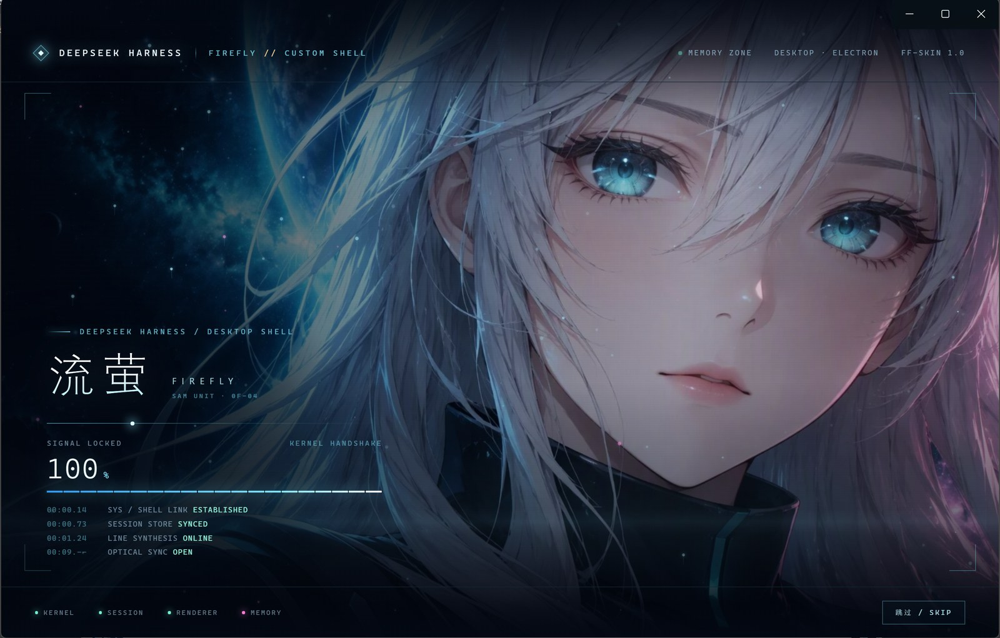

# 流萤 · Firefly — DeepSeek Harness UI 皮肤

版本：**1.0.1**  
作者：[zzzhengqi](https://github.com/zzzhengqi)  
宿主：DeepSeek Harness 桌面端 / Web GUI（`@deepseek-ai/dsh-client-modules` 客户端插件）  
许可：代码 [MIT](LICENSE) · 美术素材 [CC BY-NC 4.0](ASSETS-LICENSE.md)

「流萤 · Firefly」是作者的原创形象。这套动效最初为 Qoder 制作（`Firefly-UI-animation` v1.2.0），这里把立绘、线稿、眼部图集与动画节奏移植成 **DSH 的客户端插件**：不需要改 `app.asar`，不需要动 `index.html`，装进 profile 就能用。

> 原创形象，与《崩坏：星穹铁道》同名角色无关；本项目与米哈游、Qoder、DeepSeek 均无关联。



---

## 一、皮肤包含什么

| 模块 | 内容 |
| --- | --- |
| **启动电影** | 线条起笔 → 径向上色（闭眼）→ 睁眼（WebGL 眼睑 / 虹膜 / 睫毛 / 眨眼）→ 淡出到工作台。默认每个窗口会话播放一次；`Esc` 或右下角「跳过 / Skip」可提前结束 |
| **待机人像** | 工作台背后常驻同一个人像：呼吸、眨眼（约 20 s）、虹膜跟随鼠标、打字时瞥向输入框、发丝随气流浮动；由同一个 WebGL 着色器实时渲染，约 30 fps |
| **夜航主题** | 深墨蓝底、银白文字、信号青强调、暖金点缀。覆盖 `--dsw-*` 语义 token：侧栏、卡片、气泡、输入框、菜单、代码块、滚动条、焦点环、开关、状态色 |
| **环境层** | 最底层固定极光、两团柔光与暗角；工作台之上另有 65 只飘动的萤火（可越过面板），以及 46 只背景萤火；都不拦截点击 |
| **重播按钮** | 右下角 40 px 圆形按钮：点击重播启动电影；`Alt+点击` 打开/关闭环境光效（记忆在 localStorage） |
| **无障碍** | `prefers-reduced-motion: reduce` 时不播电影、不做粒子动画；Dom 回退路径同样可用 |

### 与 Qoder 版的差异

- 注入方式从「改 `index.html` + 打回 `app.asar`」改成 **客户端插件**：`dsh.client` + 一行 bundle patch。
- Qoder wordmark 换成 DeepSeek Harness 文案；**工作台人像保留**，但从「整屏铺满」改成带椭圆遮罩的背景层，避免压住会话正文。
- 启动节奏压缩：首次约 **8 s**（原 11 s），重播约 **10 s**，两处都可跳过。
- 电影里的文案改为 DeepSeek Harness：`SHELL LINK / SESSION STORE / LINE SYNTHESIS / OPTICAL SYNC`。
- 立绘、线稿、眼部图集、发丝权重全部转成 **WebP data URI** 内联，插件不依赖任何外部资源路径。

---

## 二、安装

### 方式 A：输入插件名安装（推荐）

打开 DSH 侧边栏 **插件** 页 → 右上角 **添加插件** → 安装源选 **npm 官方源** → 输入：

```text
dsh-firefly-skin
```

点 **安装**，装好后刷新页面或重启 DSH 即可。

> 以前用本地文件夹方式装过的话：先在插件页卸载旧的 `dsh-firefly-skin`，**完全退出 DSH（包括托盘图标）再重新打开**，然后再安装。否则 DSH 可能还会去读旧文件夹的位置，报 `ENOENT: no such file or directory`。

### 方式 B：粘贴 GitHub 链接安装

同样在 **添加插件** 里，粘贴下面的链接：

```text
https://github.com/zzzhengqi/dsh-firefly-skin.git
```

> 需要能访问 GitHub。也可以填写简写 `github:zzzhengqi/dsh-firefly-skin`。

### 方式 C：下载 zip 安装（以上两种都失败时）

1. 在 [Releases](https://github.com/zzzhengqi/dsh-firefly-skin/releases) 下载最新的 zip 并解压，把 `dsh-firefly-skin/` 文件夹放到固定位置，例如 `%USERPROFILE%\.dsh\plugins\dsh-firefly-skin`。
2. 打开 DSH 侧边栏 **插件** 页 → 右上角 **添加插件** → 选择这个文件夹。
3. 刷新页面或重启 DSH。

### 方式 D：手动挂载（开发者）

profile 目录：`%USERPROFILE%\.dsh\profiles\desktop`

1. 把包放到 `profiles\desktop\node_modules\dsh-firefly-skin`（目录联接即可）。
2. 在 `package.json` 的 `dsh.profile.bundles` 末尾加入 `"dsh-firefly-skin"`，并在 `dependencies` 中加入  
   `"dsh-firefly-skin": "link:<包的绝对路径>"`。
3. 保存后 HMR 会重新组合宿主；浏览器端的 bundle 变更会由 `dsh-client-hmr` 轮询并热替换。冷启动时也会重新读取。

### 卸载

- 插件页关闭 `dsh-firefly-skin` 开关，或在 profile 中移除 bundle / 依赖；
- 刷新后皮肤、环境层、按钮与深色覆盖全部撤掉（`dispose` 会恢复原主题属性）。

---

## 三、使用

| 操作 | 效果 |
| --- | --- |
| 首次打开 / 新窗口 | 自动播放启动电影 |
| `Esc` / 「跳过 / Skip」 | 立即结束电影 |
| 右下角圆形按钮 | 重播电影 |
| `Alt` + 点击圆形按钮 | 开/关环境光效（萤火 + 极光） |
| URL 加 `?ffboot=1` | 强制自动播放（调试用） |
| URL 加 `?ffboot=0` | 本次不自动播放 |

电影只在 `sessionStorage` 没有播放标记时自动播放；重播不受限制。系统开启「减少动态效果」时电影直接落到睁眼帧。电影结束后，工作台背景里的人像保持待机：呼吸持续、约每 20 s 眨眼一次、虹膜跟随鼠标、发丝缓慢飘动。

---

## 四、目录

```text
dsh-firefly-skin/
├─ package.json          # dsh.client: web / immediately；bundle patch 声明
├─ cordis.patch.yml      # 插入 firefly-skin 这一行
├─ lib/index.js          # 宿主半身：首帧深色画布 + 设置 deep 调色板属性
├─ client.js             # 构建产物：ModuleLoader bundle（约 1.17 MB）
├─ src/
│  ├─ engine.js          # 人像 / 萤火 / 线稿 / 睁眼引擎（移植自 v1.2.0）
│  ├─ skin.js            # 主题安装、环境层、启动电影、重播按钮
│  ├─ theme.css          # --dsw-* token 覆盖 + 环境层 + 按钮
│  └─ boot.css           # 启动电影样式（移植并收窄到 #ff-boot）
├─ tools/
│  ├─ prepare_assets.py  # 立绘 → WebP（Pillow）
│  ├─ build_boot.py      # 从原版 boot CSS 生成 src/boot.css
│  └─ build.mjs          # 内联资源与 CSS，生成 client.js
├─ assets-src/           # 生成的 WebP 纹理（不参与运行时加载）
└─ screenshots/          # 预览图
```

### 重新构建

```bash
node tools/build.mjs             # 生成 client.js（只需要 Node.js）
```

仓库里已经带有转换好的 `assets-src/*.webp`，日常构建只需要上面这一条。`tools/prepare_assets.py` 与 `tools/build_boot.py` 只在从原始 `Firefly-UI-animation` 交接包重新生成素材时使用（需要 Pillow，并把交接包放在仓库同级目录），交接包本身不在仓库中。

只改 `src/theme.css` / `src/skin.js` 时跑 `build.mjs` 即可；客户端 HMR 会在约 1–2 s 内换掉 bundle 并重新 apply（不会刷新页面）。改 `lib/index.js` 会触发宿主侧插件重载。

---

## 五、实现要点

### 主题

`html.ff-skin body` 上重写整套 `--dsw-static-*` 与 `--dsw-alias-*`：静态色板整体偏夜航蓝，`--dsw-static-deepseek-*` 换成信号青，amber 换成暖金；语义层再单独指定半透明表面、青色描边、滚动条与菜单材质。组件本身不改，只消费 token。

同时强制 `body[data-ds-dark-theme]` 与 `html { color-scheme: dark }`。`MutationObserver` 会在宿主 ThemePresenter 改主题时把属性补回去；`dispose` 时按安装前的状态恢复。

### 启动电影

完全复用 v1.2.0 的渲染路径：

- `createLineReveal`：线稿画布 + 眼睛为中心的噪声光环；
- `createPortrait`：WebGL2 片元着色器在 1792×1024 原图坐标里做眼睑滑动、睫毛带、虹膜层、呼吸、发丝与视线；
- `createEyeReveal`：WebGL2 不可用时的椭圆遮罩回退；
- `createFireflies`：130 个粒子的启动层 / 46 个的环境层。

改动只有：资源改成 data URI、按 DSH 的 `#root` 判就绪、时长参数。工作台人像见下一节。

### 待机人像（工作台背景）

`mountCompanion()` 在 `#root` 之后挂一个 `position:fixed; z-index:0` 的 `#ff-app-stage`，里面是 `.ffa-facewrap → .ffa-color → img + .ff-lids` 和眼周辉光。`createPortrait` 把 WebGL 画布插进 `.ffa-color`，`onActive` 时关闭 DOM 回退、调用 `setIdle(true)`——从这里开始呼吸、眨眼、虹膜、发丝全部由着色器逐帧计算。DOM 图片只在 WebGL2 不可用时充当静态底图 + 类名眨眼。

宿主的工作台默认由三层半透明面板叠成，人像会被压到只剩 2–3%。主题里把内层 `_root` / `_centerCol` 清成透明、把 `_frame` 收到 48%，人像的透出比例约 25%，正文仍压在暗部。**这三处选择器依赖 DSH 布局的 CSS Modules 类名后缀**（`[class$="_root"]` 等）；DSH 大版本更新后如果人像变暗或消失，检查 DevTools 里对应元素的类名并同步选择器即可。

人像只负责背景：`pointer-events:none`，不拦截点击；窗口缩放、主题切换、插件卸载都由既有的 `dispose` 清掉画布与类名。

### 工作台萤火

`mountParticles()` 在 `body` 末尾挂一个全屏 `#ffa-canvas`（`position:fixed; z-index:40`），调用 `createFireflies(canvas, { count: 65, streak: false, speed: 1.5 })`——与 Qoder 版 `#ff-app-layer` 里的 `#ffa-canvas` 一致。粒子在 UI 之上、菜单和弹窗之下（`pointer-events:none`），能飘过卡片与输入框；`dispose` 时 `stop()` 并移除画布。

### 素材

| 文件 | 用途 | 处理后 |
| --- | --- | --- |
| `firefly-face-open.jpg` | 睁眼立绘 / GL 底图 | 1792×1024 WebP q86，216 KB |
| `firefly-face-closed.jpg` | 上色阶段的闭眼图 | 1792×1024 WebP q86，203 KB |
| `firefly-eyes-atlas.jpg` | 闭眼裁切 + 巩膜 + 虹膜 | 1032×452 WebP q92，76 KB |
| `firefly-hair-flow.png` | 发丝位移权重 | 448×256 WebP 无损，18 KB |
| `firefly-face-line-draw.png` | 线稿起笔 | 1000×571 WebP 无损，293 KB |

---

## 六、已知限制

1. **这是深色皮肤**：启用期间会覆盖宿主的浅色/跟随系统偏好；卸载后恢复。
2. WebGL2 不可用、着色器编译失败或上下文丢失时，电影降级为椭圆遮罩睁眼，待机人像降级为静态底图 + 眨眼；工作台主题不受影响。
3. 眼部几何绑定 1792×1024 立绘；换图必须按 v1.2.0 的 `tools/build_portrait_assets.py` 重新标定 `PORTRAIT_GEO`。
4. 启动电影默认每个窗口会话一次；重播约 10 s，仍可 `Esc`。
5. 宿主原生菜单（应用 / 编辑）不属于 Web 内容，不受皮肤影响，仍是系统浅色菜单。
6. 插件体积约 1.17 MB，主要是内联的立绘与线稿；没有网络请求。
7. 待机人像持续占用一个 WebGL2 上下文，空闲时约 30 fps；在意功耗时可在插件页关闭皮肤。

---

## 七、素材与许可

- **代码**（插件封装、主题、宿主注入、构建脚本）：[MIT](LICENSE)，可自由使用、修改与商用。
- **美术素材**（立绘、线稿、眼部图集、发丝权重图、预览截图，包括内联在 `client.js` 里的同一批图片）：© zzzhengqi，[CC BY-NC 4.0](ASSETS-LICENSE.md)。可以自由使用和二次创作，但需要署名，且**不得用于商业目的**。需要商业授权请提 Issue。
- 「流萤 · Firefly」为原创形象，与《崩坏：星穹铁道》同名角色无关，与米哈游没有任何关联。
